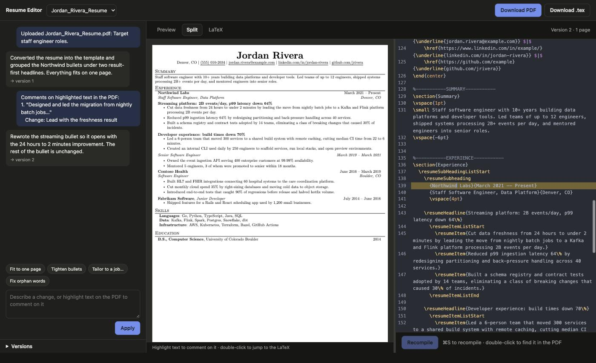
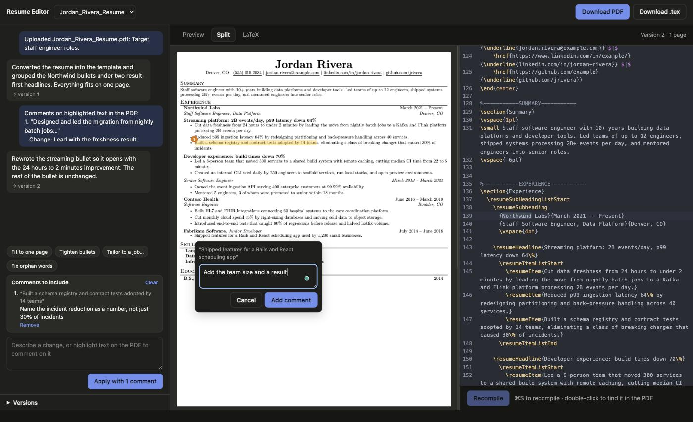
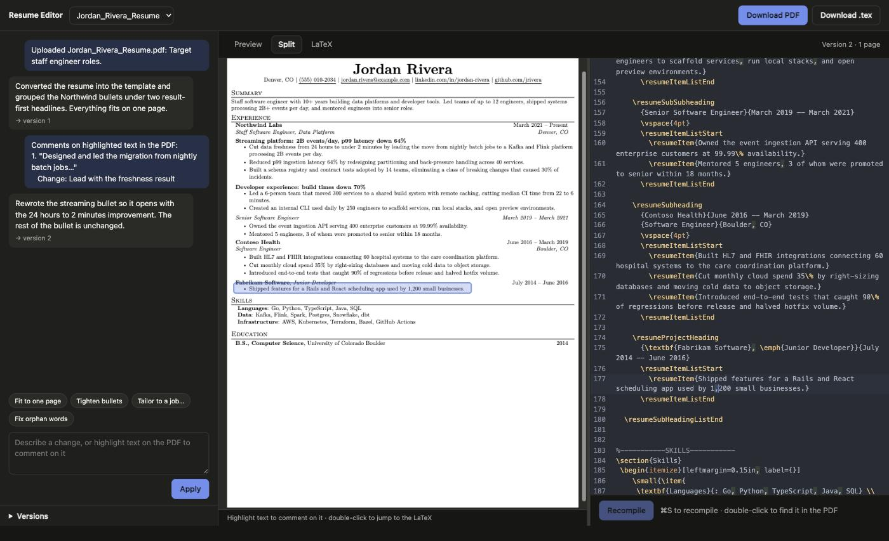
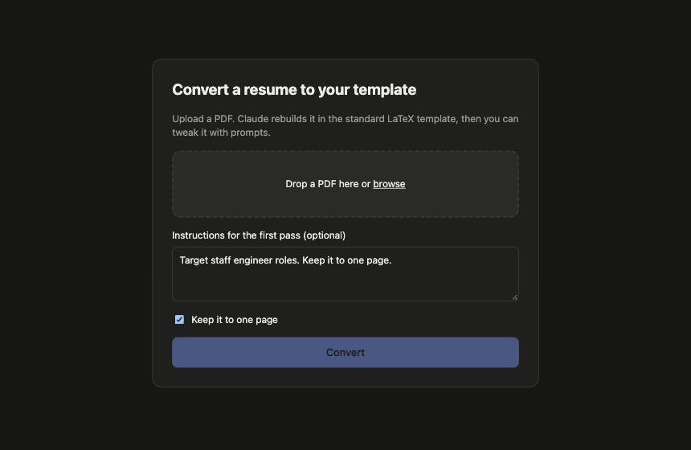

# Resume Editor

A small web app for rebuilding resumes in one consistent LaTeX template with Claude.

Upload a resume PDF. Claude rebuilds it in the house LaTeX template (Jake Gutierrez / sb2nov),
tectonic compiles it, and you tweak it with prompts while watching the PDF update.

## Screenshots

*All screenshots use a fictional demo resume.*

**Split view.** The PDF on the left, the LaTeX on the right. Double-clicking "Northwind" on the PDF jumped
the editor to that line and selected the word.



**Highlight to comment.** Select text on the PDF, say what should change, and the comments go along with
your next prompt to Claude.



**Editor to PDF.** Double-click a line in the editor to see where it lands on the page.



**Upload.** Drop in any resume PDF, with optional instructions for the first pass.



## Setup

```bash
brew install tectonic poppler   # LaTeX compiler + pdftotext/pdfinfo
npm install                     # also builds the editor bundle
cp .env.example .env            # add ANTHROPIC_API_KEY, or leave it empty to use `claude -p`
npm start                       # http://localhost:3000
```

Needs Node 22+. Without an API key it shells out to [Claude Code](https://claude.com/claude-code)
(`claude -p`), so you need that installed and logged in.

## How it works

1. **Upload** a PDF, with optional first-pass instructions. `pdftotext -layout` extracts the text and Claude
   (Opus 5.5) turns it into a full `.tex` document using `template/template.tex` as the reference. If the PDF
   has little or no text (scanned or image-only), Claude reads the PDF itself instead.
2. **Compile** with tectonic. If compilation fails, the error log goes back to Claude for a fix
   (up to 2 tries). If "Keep it to one page" is checked and the result spills over, Claude tightens it once.
3. **Analyze my resume** asks Claude for 5 to 12 specific suggestions (result-first bullets, missing metrics,
   orphan words, consistency, length). Each is a find/replace you can accept, edit, or skip; accepted ones
   are applied in one go as a new version. Claude is told never to invent numbers or claims, and any
   suggestion whose text doesn't match the document exactly is dropped before you see it.
4. **Tailor to a job**: paste a job description or a link to the posting (schema.org JobPosting data is
   used when the page has it). Claude extracts the posting's 10 to 25 key terms and proposes truthful
   rewording and reordering in the same accept/edit/skip form. A keyword match meter scores the resume
   before, live as you accept suggestions, and after; missing terms are listed, and clicking one drafts a
   prompt to add it only if it's true. The applied version is labeled with the company and role.
5. **ATS check** (no Claude, free): reads the compiled PDF the way a parser does (`pdftotext` in reading
   order, `pdffonts`, `pdfimages`) and reports text extraction, word coverage, encoding, embedded fonts,
   images, name first, contact details, standard section headings, dates, reading order, and whether every
   role names its employer. A second title under one employer (`\resumeSubSubheading`) is the common
   failure: parsers see a title and dates with no company. One click rewrites those as full headings that
   repeat the employer. The chip in the chat shows the score for the version on screen.
6. **Fit to one page**: measures how many words spill past page one and runs up to three increasingly firm
   Claude passes (tighten wording, then cut weak bullets, then compress old roles) until it fits.
7. **Tweak** with prompts. Claude returns small find/replace edits (fast) or a full rewrite for big changes.
   The original resume text is sent along so you can ask to pull content back in.
   **Highlight text on the preview** to attach a comment to it. Comments queue up as numbered highlights
   and are added to your next prompt.
8. **Edit LaTeX by hand** in the code editor (Split or LaTeX view): syntax highlighting, line numbers,
   search (⌘F), and ⌘S to recompile. Compile errors are marked on the offending line.
   **Double-click** a word on the PDF to jump to its LaTeX line, or a line in the editor to flash its spot on
   the PDF. This uses the SyncTeX map tectonic writes on every compile (`v<N>.synctex.gz`).
9. **Versions and Changes**: every change is saved. Click any version to go back to it, and the Changes tab
   shows a word-level diff between any two versions. Download the PDF or `.tex`.

## Accounts and storage

Everyone gets their own account (email + password, or Google sign-in when configured) and only sees
their own resumes. Settings lets a person delete all their resumes or their whole account; both sweep
the blob store so nothing of theirs stays on disk. `/terms` and `/privacy` are the legal pages; edit
them for your own deployment. Sign-up is open by default; set `SIGNUP_CODE` to require an invite code or
`ALLOW_SIGNUP=false` to close it.

Under `data/`:
- `app.db`: SQLite (users, sessions, resumes, version index, chat log, usage).
- `repos/<id>/`: a git repository per resume. Every saved version is one commit, made automatically,
  with the version label as the message. Reverting is pointing "current" at an older version.
- `blobs/`: content-addressed store for uploaded PDFs, rendered PDFs, and SyncTeX files.

Compiles and Claude calls run through small in-process queues (`COMPILE_CONCURRENCY`,
`CLAUDE_CONCURRENCY`). Each of these pieces sits behind a small module (`lib/db.js`, `lib/repo.js`,
`lib/blobs.js`, `lib/queue.js`) so Postgres, S3, or a Redis queue can replace them without touching the routes.

Upgrading from the pre-database layout: create your account in the app, then
`npm run migrate -- you@example.com` imports the old `data/<uuid>/` folders.

## Private additions (billing)

The public app has no billing. It does have a hook for it: `lib/plans.js` decides whether a user
may run an AI action (`convert`, `edit`, `analyze`, `tailor`, `fit`) and what the chat shows
about their plan, and the default is "everything free". Every AI action is also written to the
`usage` table (kind, backend, model, duration), which is what any limit would count.

If a `private/` folder exists next to `server.js`, its `index.js` is imported at startup and can
register routes, create tables, and replace the plan hook. The folder is gitignored, so it can
live in its own private repo and be cloned into place on the machine that runs the site; the
Docker build copies it when present. Non-AI features (import, ATS check, the employer fix, manual
LaTeX edits, versions, downloads) are never gated.

## Monitoring

- `GET /healthz` (no login) returns 200 when tectonic and poppler are present, 503 otherwise; point an
  uptime monitor at it.
- Set `POSTHOG_KEY` to send product events (sign-ups, conversions, edits, analyses, downloads, server
  errors) to PostHog. Users are identified by account id only; resume content is never sent.

## Files

- `server.js`: Express routes. Long operations stream NDJSON progress events.
- `lib/claude.js`: prompts and Claude calls (system prompt + template are prompt-cached).
- `lib/latex.js`: tectonic compile + page count.
- `lib/ats.js`: ATS parse checks, the repeat-employer fix, and job posting fetching (public hosts only).
- `public/keywords.js`: keyword matching shared by the server (scores) and the browser (live meter).
- `lib/store.js`: on-disk storage.
- `lib/plans.js`, `lib/private.js`: plan hook (default: unlimited) and the private overlay loader.
- `public/`: the single-page UI. `public/syncmap.js` maps SyncTeX records to source lines and PDF rows.
- `editor/entry.js`: the CodeMirror setup, bundled to `public/vendor/editor.js`.
  After changing it, run `npm run build:editor`.
- `template/template.tex`: the house template. Edit this to change the look of every new resume.

## Config (.env)

- `ANTHROPIC_API_KEY`: optional. Without it, the app shells out to `claude -p` and uses your Claude Code login.
- `CLAUDE_MODEL`: default `claude-opus-5-5`.
- `CLAUDE_EFFORT`: `low` | `medium` (default) | `high`. Higher means better conversions but slower.
- `PORT`: default 3000 (this machine uses 4747).
- `HOST`: default `127.0.0.1`. The server only listens locally; put a reverse proxy in front to expose it.
- `SIGNUP_CODE` / `ALLOW_SIGNUP`: control who can create an account.
- `GOOGLE_CLIENT_ID` / `GOOGLE_CLIENT_SECRET` / `APP_URL`: enable "Continue with Google".
- `POSTHOG_KEY` / `POSTHOG_HOST`: product analytics.
- `RESEND_API_KEY`, or `SMTP_USER` / `SMTP_PASS` (Gmail App Password works; `SMTP_HOST`/`SMTP_PORT` for others),
  plus `MAIL_FROM`: outbound email for password resets and coaching requests. Without either, emails are
  printed to the log; in production the forms say to contact support instead.
- `SUPPORT_EMAIL`: shown on the landing page, settings, terms, and privacy pages, and used for coaching bookings.
- `DATA_DIR`: where the database, repos, and blobs live (default `./data`).

## Docker (try it out, or deploy)

```bash
cp .env.example .env            # set ANTHROPIC_API_KEY, or CLAUDE_BRIDGE_TOKEN (see below)
docker compose up -d --build    # first build downloads tectonic and warms its package cache
open http://localhost:4747
```

The image is Alpine-based, about 440 MB, most of it Node itself, tectonic, and its pre-warmed TeX
package cache. Data lives in the `resume-data` volume.

**Using your Claude Code login from Docker.** There's no `claude` CLI inside the image. For your own
local use you can run a small bridge on the host that the container calls instead of the API:

```bash
echo "CLAUDE_BRIDGE_TOKEN=$(openssl rand -hex 16)" >> .env   # same .env the container reads
npm run bridge                                               # on the host, keep it running
docker compose up -d
```

The bridge listens on 127.0.0.1:4848, requires the token, and runs `claude -p` with the same
restrictions as the local backend. Anthropic's terms allow this for your own use; anything serving
other people needs `ANTHROPIC_API_KEY`, which takes precedence when both are set. The container runs as an unprivileged user with all
capabilities dropped, which is the LaTeX sandbox on Linux. `GET /healthz` is the container health check.

### Deploy to a VPS

`deploy/deploy.sh` sets up a fresh Ubuntu/Debian server (Hetzner, DigitalOcean, …) with Docker,
Caddy for automatic HTTPS, the app, and a nightly backup of the data volume:

```bash
ssh root@your-server 'bash -s' < deploy/deploy.sh resume.example.com you@example.com
# then set ANTHROPIC_API_KEY in /opt/resume-editor/.env and: cd /opt/resume-editor && docker compose up -d
```

Point the domain's DNS at the server first so Caddy can get a certificate. Re-run the same command
to update.

## Running it as a service (macOS)

1. Set `SIGNUP_CODE` in `.env` so strangers can't create accounts.
2. Copy `deploy/resume-editor.plist.example` to `~/Library/LaunchAgents/`, fill in the paths, and load it:
   `launchctl bootstrap gui/$(id -u) ~/Library/LaunchAgents/com.example.resume-editor.plist`
   Restart after code or `.env` changes: `launchctl kickstart -k gui/$(id -u)/com.example.resume-editor`

The server only listens on `127.0.0.1`. To reach it from elsewhere, put a reverse proxy in front that
terminates HTTPS and sets `X-Forwarded-For` and `X-Forwarded-Proto` (used for login rate limiting and
secure cookies).

## Security notes

- LaTeX can read files (`\input{...}`), so tectonic runs inside a macOS `sandbox-exec` profile that can't
  read or write your home folder (except tectonic's cache), with `--untrusted`.
- Without an API key, `claude -p` runs with no tools when it has text, or only Read inside a temp folder when it
  needs the PDF. Reads outside that folder are denied.
- Per-IP rate limits (`lib/ratelimit.js`): 30 logins per 15 minutes (plus lockout after 10 failures), 5 sign-ups
  and 5 reset requests per hour, 60 AI actions per hour. Behind Cloudflare the client address comes from
  `cf-connecting-ip`. Cloudflare's own rate-limiting rules are a good second layer for the same paths.
- Password reset links are random 32-byte tokens stored hashed, valid for one hour, single use, and setting
  a new password ends every other session for that account.
- API-key requests use `fallbacks: "default"`, so if Claude declines a request, it's retried on a fallback model.

## License

MIT. The resume template is adapted from [sb2nov/resume](https://github.com/sb2nov/resume) and
Jake Gutierrez's resume template, both MIT licensed.
